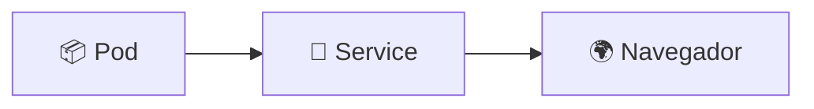

# Estilo de los README

Referencia de la skill `mejorar-clase`. Copia la estructura de los módulos 13, 14 y 15; aquí está condensada.

## Idioma y tono

- Todo en **español**.
- Directo y en segunda persona ("despliega", "comprueba"), no en impersonal.
- Explica el **por qué** de cada requisito raro; no narres la historia del repo.

## Títulos

- `#` solo para el título del módulo.
- `##` con emoji: `## 🚀 Paso 2: desplegar en Kubernetes`.
- `###` para subsecciones y para cada paso numerado: `### 3️⃣ Ejecutar el backup manual (Job)`.
- **No repetir emoji** entre dos `##` del mismo documento (usar `🔄` y `🔁` a la vez confunde).
- Sin numeración manual en `##` si el módulo usa pasos (`Paso 1`, `Paso 2`…); las secciones de apoyo (conceptos, troubleshooting) van sin número.

## Bloques de código

- Siempre con lenguaje: ` ```bash `, ` ```yaml `, ` ```text `, ` ```mermaid `.
- Los `text` son para salidas de comandos y árboles de archivos, nunca para diagramas.
- Un bloque = un objetivo (comando, salida, manifiesto). No mezclar "lo que haces" con "lo que sale".
- Bloques balanceados: un ` ``` ` de apertura y otro de cierre (el script lo verifica).

## Tablas

Úsalas cuando comparas 3+ cosas. Convenciones:

| Caso | Formato |
|------|---------|
| Comparar dos entornos | una columna por entorno, con el comando completo |
| Enum de valores de un campo | `Campo \| Default \| Qué hace` |
| Troubleshooting | `Síntoma \| Causa probable \| Solución` |
| Archivos del módulo | `Archivo \| Recursos que crea` |

- Síntoma literal entre backticks (`ErrImagePull`, `TARGETS: <unknown>`), para que se pueda buscar.
- La solución debe ser un comando o una acción concreta, no "revisa la configuración".

## Diagramas (Mermaid)

Solo si aportan: arquitectura, flujo causal, ciclo de vida. Reglas:

- `flowchart` para arquitectura y flujos; nodos con emoji y `<br/>` para partir texto.
- Máximo 6–8 nodos; si necesitas más, divide en dos diagramas o usa tabla.
- Nada de ASCII art ni cajas dibujadas con `+---+`.
- Verifica que abre y cierra con ` ```mermaid `.

Ejemplo mínimo:



## Anatomía de un paso

Todo paso que ejecuta algo debe tener las tres partes:

````markdown
### 2️⃣ Desplegar

```bash
kubectl apply -f k8s/backend/
kubectl wait --for=condition=Ready pod -l app=backend --timeout=180s
```

Salida esperada:

```text
NAME                                  READY   STATUS    RESTARTS   AGE
backend-deployment-6cd964975f-qfrkg   1/1     Running   0          40s
```

> ⚠️ Si queda en `ErrImagePull`, vuelve al paso 1 (ruta de tu entorno) y repite.
````

Reglas del paso:

1. Comando copiable tal cual (con `cd` si hace falta cambiar de carpeta).
2. **Cómo comprobar** que salió bien (comando o salida esperada).
3. Qué hacer si falla, con el síntoma literal.

## Avisos (`>` blockquotes)

| Emoji | Uso |
|-------|-----|
| ⚠️ | Error frecuente o requisito que se olvida |
| ❗ | Bloqueante: sin esto no funciona |
| 💡 | Atajo o aclaración |
| 🔑 | Idea clave del módulo |
| 🧠 | Por qué pasa algo (modelo mental) |
| 🔁 | Volver a ejecutar / reconstruir |
| 🧯 | Referencia a troubleshooting |

Un aviso por idea. Si necesitas dos seguidos, probablemente son uno solo.

## Troubleshooting

- Una fila por síntoma **real** (si lo viviste o lo dice el manifiesto; no inventes).
- El síntoma entre backticks y lo más literal posible: es lo que el usuario pegará en el buscador.
- Incluye el caso "me equivoqué de entorno" cuando el módulo dependa de minikube.

## Limpieza y navegación

```markdown
## 🧹 Limpieza

```bash
kubectl delete -f k8s/backend/ -f k8s/frontend/
```

## 🧭 Navegación

- ⏱️ [Módulo anterior: Jobs y CronJobs](../14-jobs-cronjobs/README.md)
- 📚 [Inicio del curso](../README.md)
```

- La limpieza debe dejar el clúster como estaba (incluye los addons si los habilitaste).
- Cierra con el pie del curso: `🧠 *Resumen del módulo "…" del curso de Platzi.*`

## Enlaces

- Relativos y con `../` cuando corresponda. Nunca rutas absolutas del autor.
- Anclas (`#seccion`): evitarlas; el slug con emoji cambia entre renderizadores. Mejor: "[módulo 13](../13-multi-tier/README.md), sección **Recompilar tras editar el código**".
- Al añadir o renombrar un módulo: actualizar la tabla **y** el árbol del `README.md` raíz.
