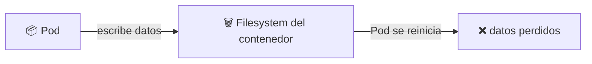
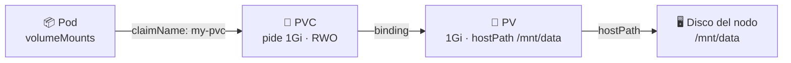
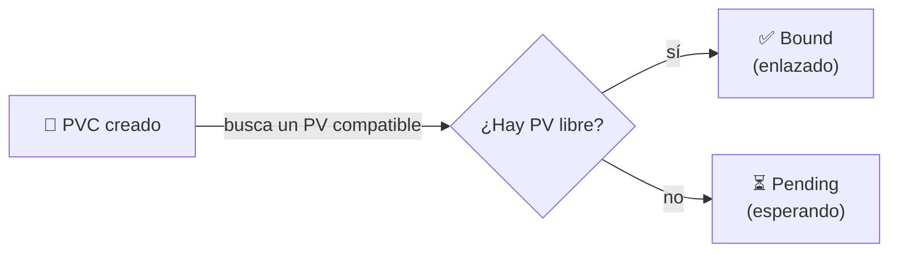

# 💾 Almacenamiento: PersistentVolume y PersistentVolumeClaim

> Los contenedores son **efímeros**: si un Pod se reinicia, todo lo que escribió dentro de su filesystem se pierde. Para conservar datos entre reinicios (y entre nodos) Kubernetes usa **Volumes**, **PersistentVolume (PV)** y **PersistentVolumeClaim (PVC)**.

## 🧠 El problema: los datos se van con el Pod



Un `emptyDir` o el propio filesystem del contenedor viven **atados a la vida del Pod**. Para datos que deben sobrevivir necesitamos un **volumen persistente**.

## 🧩 Los conceptos

| Recurso | Qué es | Alcance |
|---------|--------|---------|
| 📦 **Volume** | Almacenamiento montado en un Pod | Se declara dentro del Pod |
| 💾 **PersistentVolume (PV)** | Un "trozo" de almacenamiento real del clúster | Recurso del clúster (no de un namespace) |
| 📄 **PersistentVolumeClaim (PVC)** | Una **solicitud** de almacenamiento hecha por un usuario | Recurso del namespace |
| 🏷️ **StorageClass** | Define **cómo** se aprovisiona el almacenamiento (estático o dinámico) | Recurso del clúster |



> 💡 **La clave**: el **Pod no conoce el almacenamiento físico**. Solo pide un PVC ("quiero 1Gi de solo lectura/escritura"). El PVC se **enlaza** (*binds*) a un PV que cumpla los requisitos. Eso desacopla la app de la infraestructura.

## 🔄 Ciclo de vida: Pending → Bound



| Estado del PVC | Significa |
|:--------------:|-----------|
| ⏳ **Pending** | Aún no encuentra un PV que cumpla (tamaño, accessMode, labels, storageClass) |
| ✅ **Bound** | Ya está enlazado a un PV; el Pod puede montarlo |

## 🏠 hostPath: el backend de este ejemplo

En este módulo el PV usa **`hostPath`**: monta una **carpeta del nodo** (del propio host donde corre el Pod). Es lo más simple para practicar, pero **solo vale para un nodo** y **no se usa en producción** (los datos quedan atrapados en esa máquina).

```yaml
spec:
  hostPath:
    path: /mnt/data
    type: Directory   # el directorio DEBE existir antes
```

> ⚠️ Como `type: Directory` exige que la carpeta ya exista, el **primer paso** es crearla **dentro del nodo** (con permisos de root).

## 🚀 Práctica paso a paso

### 1️⃣ Crear el directorio en el nodo

El `hostPath` apunta a `/mnt/data` **dentro del nodo**, así que hay que crear esa carpeta ahí (no en tu equipo). El comando cambia según el clúster:

| Entorno | Cómo entrar al nodo |
|---------|---------------------|
| 🌀 minikube | `minikube ssh` |
| 🐳 Docker Desktop | `kubectl debug node/docker-desktop -it --image=busybox -- sh` (el disco del nodo se monta en `/host`) |

```bash
# 🌀 minikube
minikube ssh
sudo mkdir -p /mnt/data
echo '<h1>Hello from Volume!</h1>' | sudo tee /mnt/data/index.html
exit
```

```bash
# 🐳 Docker Desktop (sin minikube)
kubectl debug node/docker-desktop -it --image=busybox -- sh

# Ya dentro del shell del nodo:
mkdir -p /host/mnt/data
echo '<h1>Hello from Volume!</h1>' > /host/mnt/data/index.html
exit
```

> 💡 El contenido coincide con el archivo [tmp-files/index.html](tmp-files/index.html) del repo. En Docker Desktop, `/host` es la **raíz del nodo**, por eso el archivo va en `/host/mnt/data/` (que equivale al `/mnt/data` que ve el PV).

### 2️⃣ Aplicar el PV y el PVC

Manifiesto: [pv-pvc.yaml](pv-pvc.yaml) — crea los **dos** objetos (PV + PVC) separados por `---`.

```bash
kubectl apply -f pv-pvc.yaml
```

```yaml
apiVersion: v1
kind: PersistentVolume
metadata:
  name: my-pv
  labels:
    type: local
    app: nginx-storage
spec:
  capacity:
    storage: 1Gi
  accessModes:
    - ReadWriteOnce
  storageClassName: manual
  hostPath:
    path: /mnt/data
    type: Directory
```

> 🔑 El PV lleva **labels** (`type: local`, `app: nginx-storage`) y el PVC las **selecciona** con `selector.matchLabels`. Así el enlace es explícito (en vez de dejar que Kubernetes elija cualquier PV libre).

### 3️⃣ Crear el Pod que monta el PVC

Manifiesto: [pod.yaml](pod.yaml) — un nginx que monta el PVC en su carpeta web.

```bash
kubectl apply -f pod.yaml
```

```yaml
kind: Pod
metadata:
  name: my-pod
spec:
  containers:
    - name: my-container
      image: nginx
      volumeMounts:
        - mountPath: /usr/share/nginx/html   # carpeta web de nginx
          name: my-storage
  volumes:
    - name: my-storage
      persistentVolumeClaim:
        claimName: my-pvc                    # ← el PVC, no el PV
```

> 💡 El Pod referencia el **PVC** (`claimName: my-pvc`), **nunca** el PV directamente. Montamos el volumen sobre `/usr/share/nginx/html` para que nginx sirva el `index.html` que pusimos en el nodo.

### 4️⃣ Verificar el enlace y el montaje

```bash
# PV y PVC deben aparecer en estado Bound
kubectl get pv,pvc

# El Pod debe estar Running
kubectl get pod my-pod

# Comprobar que el archivo está montado dentro del contenedor
kubectl exec my-pod -- ls -la /usr/share/nginx/html
kubectl exec my-pod -- cat /usr/share/nginx/html/index.html
```

| Objeto | Estado esperado |
|--------|-----------------|
| `my-pv` (PV) | `Bound` con `my-pvc` |
| `my-pvc` (PVC) | `Bound` con `my-pv` |
| `my-pod` | `Running` |

### 5️⃣ Probar el servidor

```bash
kubectl port-forward my-pod 8080:80
```

Abre **http://localhost:8080** en tu navegador y verás el `<h1>Hello from Volume!</h1>` servido desde el volumen.

> 💡 `port-forward` funciona en cualquier clúster (Docker Desktop, minikube, etc.), sin necesidad de minikube tunnel.

### 6️⃣ Limpieza

```bash
kubectl delete pod my-pod
kubectl delete -f pv-pvc.yaml
```

## 📋 AccessModes y Reclaim Policies

### AccessModes (modos de acceso)

| Modo | Abrev. | Significa |
|------|:------:|-----------|
| **ReadWriteOnce** | `RWO` | Montado lectura/escritura en **un solo nodo** |
| **ReadOnlyMany** | `ROX` | Montado solo lectura en **varios nodos** |
| **ReadWriteMany** | `RWX` | Lectura/escritura en **varios nodos** |
| **ReadWriteOncePod** | `RWOP` | Lectura/escritura en **un solo Pod** |

> 🔑 Este ejemplo usa `RWO`: el volumen se monta en un único nodo (suficiente con `hostPath`).

### Reclaim Policy (qué pasa al borrar el PVC)

| Política | Qué hace con los datos |
|----------|------------------------|
| 🔁 **Retain** | Conserva el PV y los datos (hay que limpiarlo a mano) |
| 🗑️ **Delete** | Borra el PV y el almacenamiento asociado (típico en la nube) |
| ♻️ **Recycle** | *(obsoleto)* vaciaba el volumen |

## ⚠️ Static vs. Dynamic provisioning

| | Aprovisionamiento **estático** | Aprovisionamiento **dinámico** |
|---|---|---|
| Quién crea el PV | Tú, a mano | La **StorageClass** lo crea al pedir el PVC |
| Cuándo usarlo | Laboratorio, volúmenes preexistentes | Nube/producción |
| Este ejemplo | ✅ (`storageClassName: manual`) | ❌ |

> 💡 En la nube normalmente **no** creas PVs a mano: defines una **StorageClass** (ej. `gp3` en AWS, `standard` en GCP) y al crear el PVC, el clúster **aprovisiona** el disco automáticamente. `storageClassName: manual` en este ejemplo **desactiva** ese comportamiento para forzar el enlace con nuestro PV.

## 🧭 Navegación

- 🔀 [Módulo anterior: Tipos de Services](../10-services-clusterip-nodeport-loadbalancer/README.md)
- ↩️ [Inicio del curso](../README.md)

---

🧠 *Resumen del módulo "Almacenamiento: PersistentVolume y PersistentVolumeClaim" del curso de Platzi.*
