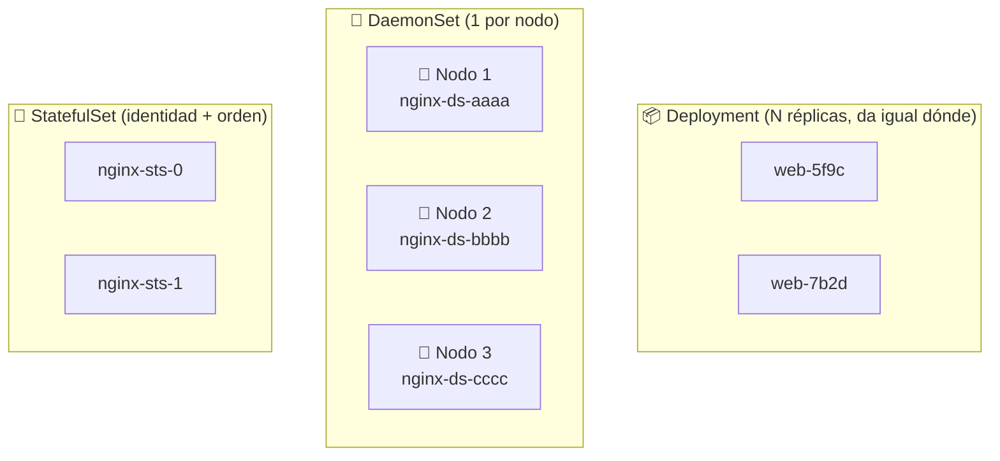
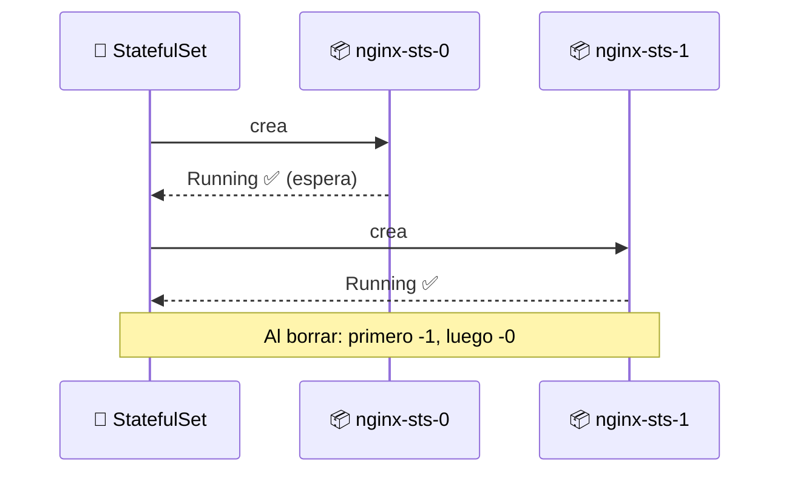
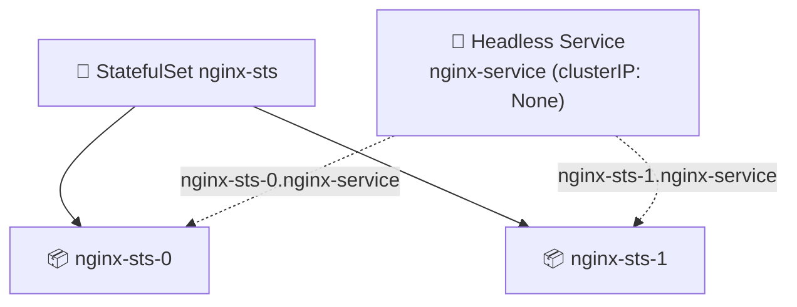

# 🔁 DaemonSets y StatefulSets

> Un **Deployment** sirve para apps **sin estado**: los Pods son intercambiables (`web-5f9c…`, `web-7b2d…`). Pero hay dos casos que no encajan ahí: los agentes que deben correr en **cada nodo** y las apps que necesitan **identidad y almacenamiento estables**. Para eso existen **DaemonSet** y **StatefulSet**.

## 🧠 Tres controladores, tres propósitos

| Controlador | ¿Cuántos Pods? | Identidad | Almacenamiento | Caso típico |
|-------------|----------------|-----------|----------------|-------------|
| 📦 **Deployment** | `replicas` (lo que pidas) | 🎲 Aleatoria e intercambiable | Compartido / efímero | Web, API (stateless) |
| 🔁 **DaemonSet** | **Uno por nodo** | Ligada al nodo | Normalmente efímero | Agentes por nodo (logs, métricas) |
| 💠 **StatefulSet** | `replicas` (en orden) | 🔒 **Estable** (`app-0`, `app-1`…) | **Por Pod** y persistente | Bases de datos, colas |



## 🔁 DaemonSet

Garantiza que **una copia del Pod corra en cada nodo** (o en los que cumplan un `nodeSelector`/`affinity`). Si añades un nodo al clúster, el DaemonSet le crea su Pod automáticamente; si lo quitas, lo borra.

**Casos de uso** (agentes que deben estar en *todos* los nodos):

- 📋 Recolectores de logs (Fluentd, Filebeat)
- 📈 Métricas/observabilidad (node-exporter, Datadog agent)
- 🌐 Plugins de red y kube-proxy (ellos mismos son DaemonSets)
- 💾 Demonios de almacenamiento (ej. GlusterFS, Ceph)

### Manifiesto: [daemonset.yaml](daemonset.yaml)

```yaml
apiVersion: apps/v1
kind: DaemonSet
metadata:
  name: nginx-ds
spec:
  selector:
    matchLabels:
      app: nginx-app
  template:
    metadata:
      labels:
        app: nginx-app
    spec:
      containers:
      - name: nginx
        image: nginx
        ports:
        - containerPort: 80
          name: http
```

```bash
kubectl apply -f daemonset.yaml
kubectl get ds
#   NAME       DESIRED   CURRENT   READY   ...   AGE
#   nginx-ds   1         1         1             10s   ← 1 porque el clúster tiene 1 nodo
kubectl get pods -l app=nginx-app -o wide
```

> 💡 **No se especifica `replicas`**: el número de Pods lo decide la **cantidad de nodos**. En un clúster de 3 nodos verás 3 Pods `nginx-ds-*`, uno por nodo (mira la columna `NODE` con `-o wide`).

## 💠 StatefulSet

Es como un Deployment pero para apps **con estado**. Aporta tres garantías que un Deployment no tiene:

| Garantía | Qué significa |
|----------|---------------|
| 🔒 **Identidad estable** | Los Pods se llaman `nginx-sts-0`, `nginx-sts-1`… y **conservan** ese nombre aunque se reinicien |
| 🌐 **Red estable** | Cada Pod tiene su **DNS propio** vía un *headless service* |
| 💾 **Almacenamiento estable** | Cada Pod mantiene **su propio** volumen (los datos no "saltan" entre réplicas) |

### Orden de creación y borrado

A diferencia de un Deployment (todos en paralelo), el StatefulSet es **secuencial**: crea el `-0`, espera a que esté `Ready`, luego el `-1`, y así. Al borrar, lo hace en orden inverso.



> 🔑 Esa identidad predecible es lo que permite a una base de datos saber quién es el primario y quién la réplica.

### El *headless service*

El StatefulSet necesita un **Service headless** (`clusterIP: None`). No balancea: en lugar de una IP, da **DNS por Pod**.



| Service normal (ClusterIP) | Service **headless** |
|----------------------------|----------------------|
| Una IP virtual que balancea | **Sin** IP (`clusterIP: None`) |
| Devuelve la IP del Service | Devuelve las **IPs de todos los Pods** |
| `nginx-service` → pods | `nginx-sts-0.nginx-service` → **ese** pod concreto |

### Manifiesto: [statefulset.yaml](statefulset.yaml)

Incluye el StatefulSet **y** el headless Service separados por `---`:

```yaml
apiVersion: apps/v1
kind: StatefulSet
metadata:
  name: nginx-sts
spec:
  serviceName: nginx-service   # ← el headless service
  replicas: 2
  selector:
    matchLabels:
      app: nginx-app
  template:
    metadata:
      labels:
        app: nginx-app
    spec:
      containers:
      - name: nginx
        image: nginx
        volumeMounts:
        - name: nginx-storage
          mountPath: /usr/share/nginx/html
      volumes:
      - name: nginx-storage
        persistentVolumeClaim:
          claimName: nginx-pvc
---
apiVersion: v1
kind: Service
metadata:
  name: nginx-service
spec:
  clusterIP: None   # ← headless
  selector:
    app: nginx-app
  ports:
  - port: 80
    name: http
    targetPort: 80
```

> ⚠️ **Simplificación de este ejemplo**: las 2 réplicas montan **el mismo PVC** (`nginx-pvc`). En producción un StatefulSet usa **`volumeClaimTemplates`** para que **cada Pod tenga su propio volumen** (si no, compartirían datos). Lo verás abajo.

## 🚀 Práctica paso a paso

### 1️⃣ DaemonSet

```bash
kubectl apply -f daemonset.yaml

kubectl get ds
kubectl get pods -l app=nginx-app -o wide   # fíjate en la columna NODE
```

### 2️⃣ Preparar el almacenamiento (PV + PVC)

El StatefulSet monta el PVC `nginx-pvc`, que se enlaza con el PV `nginx-pv` ([pv-pvc.yaml](pv-pvc.yaml)). Igual que en el [módulo de almacenamiento](../11-storage-pv-pvc/README.md), el PV usa `hostPath: /mnt/data` con `type: Directory`, así que **esa carpeta debe existir en el nodo** antes de aplicar.

```bash
kubectl apply -f pv-pvc.yaml
```

> 📌 Si `/mnt/data` no existe en el nodo, el Pod fallará al montar. Revisa la sección "Práctica paso a paso" del [módulo 11](../11-storage-pv-pvc/README.md) para crearla (con `minikube ssh` o `kubectl debug node/docker-desktop`).

### 3️⃣ StatefulSet

```bash
kubectl apply -f statefulset.yaml
```

### 4️⃣ Verificar la identidad y el orden

```bash
kubectl get sts
#   NAME        READY   AGE
#   nginx-sts   2/2     20s

kubectl get pods -l app=nginx-app
#   nginx-sts-0   Running   ← nombres ESTABLES, no aleatorios
#   nginx-sts-1   Running

kubectl get pvc nginx-pvc         # Bound
kubectl get svc nginx-service     # clusterIP: None (headless)
```

Comprueba el **DNS por Pod** (desde otro Pod dentro del clúster):

```bash
kubectl run test --rm -it --image=busybox --restart=Never -- \
  nslookup nginx-sts-0.nginx-service
```

> 🔍 Un **Deployment** generaría nombres aleatorios; aquí cada Pod tiene **nombre y DNS fijos**: `nginx-sts-0.nginx-service.default.svc.cluster.local`.

### 5️⃣ Identidad que se conserva

```bash
kubectl delete pod nginx-sts-1
kubectl get pods -l app=nginx-app   # vuelve a aparecer nginx-sts-1 (mismo nombre, misma "identidad")
```

### 6️⃣ Limpieza

```bash
kubectl delete sts nginx-sts
kubectl delete -f daemonset.yaml
kubectl delete -f pv-pvc.yaml
```

> 💡 Borrar un StatefulSet **no** borra sus PVCs por defecto (protege los datos). Si quieres eliminarlos: `kubectl delete pvc -l app=nginx-app` o `kubectl delete pvc --all`.

## 🧩 El patrón real: `volumeClaimTemplates`

En lugar de un PVC compartido a mano, el StatefulSet crea **un PVC por Pod** a partir de una plantilla:

```yaml
spec:
  serviceName: nginx-service
  replicas: 2
  template: { ... }        # (aquí va el Pod, con volumeMounts: name: nginx-storage)
  volumeClaimTemplates:    # ← uno por réplica: nginx-storage-nginx-sts-0, nginx-storage-nginx-sts-1
  - metadata:
      name: nginx-storage
    spec:
      accessModes: ["ReadWriteOnce"]
      storageClassName: manual
      resources:
        requests:
          storage: 1Gi
```

| | PVC compartido (este ejemplo) | `volumeClaimTemplates` (producción) |
|---|---|---|
| Volúmenes | 1 para todas las réplicas | 1 **por Pod** |
| Datos | Se pisan entre sí | Aislados por Pod |
| Uso | Demo / aprendizaje | Bases de datos, colas |

## 🧠 Resumen: ¿cuándo usar cuál?

| Necesitas... | Usa |
|--------------|:---:|
| N copias idénticas e intercambiables de una app | 📦 Deployment |
| Un agente corriendo en **cada nodo** | 🔁 DaemonSet |
| Identidad estable, orden y **almacenamiento por instancia** | 💠 StatefulSet |

> ⚠️ Para datos, el StatefulSet normalmente se combina con **StorageClasses** y volúmenes reales de nube, no `hostPath` (que ata los datos a un solo nodo). Ver [módulo 11](../11-storage-pv-pvc/README.md).

## 🧭 Navegación

- 💾 [Módulo anterior: Almacenamiento (PV/PVC)](../11-storage-pv-pvc/README.md)
- ↩️ [Inicio del curso](../README.md)

---

🧠 *Resumen del módulo "DaemonSets y StatefulSets" del curso de Platzi.*
