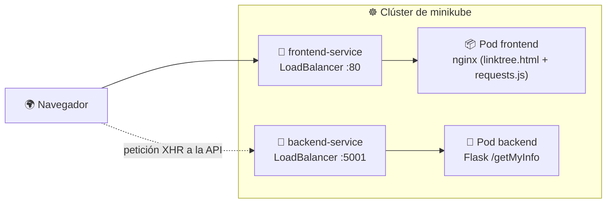
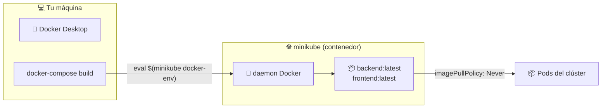

# 🧱 Aplicación multi-tier: frontend + backend en Kubernetes

> Hasta ahora cada módulo desplegaba **un** contenedor. Una app real casi nunca es así: tiene un **frontend** que sirve HTML/JS y un **backend** que expone una API. Este módulo empaqueta ambos, los publica con **Deployments** y los conecta con **Services** dentro del clúster.

## 🗺️ Qué vas a construir



- 🖥️ El **frontend** es un nginx que sirve un *linktree* estático y, vía JavaScript, pide los datos al backend.
- 🐍 El **backend** es una API Flask con un único endpoint, `/getMyInfo`, que devuelve un JSON (nombre, redes sociales, blog…).
- 🔌 Cada capa tiene su **Deployment** (dueño de los Pods) y su **Service** (nombre DNS estable y balanceo).

## 📁 Estructura del proyecto

```text
📦 13-multi-tier/
├── 📄 README.md
└── 📁 curso-de-docker-fundamentos/
    ├── 📄 docker-compose.yml          # 1️⃣ probar las 2 capas sin K8s
    ├── 📁 backend/
    │   ├── 📄 app.py                  #   API Flask (puerto 5001)
    │   ├── 📄 requirements.txt        #   Flask + flask_cors + waitress
    │   └── 📄 Dockerfile
    ├── 📁 frontend/
    │   ├── 📄 Dockerfile              #   nginx:latest + copia de /sitio
    │   └── 📁 sitio/
    │       ├── 📄 linktree.html       #   página estática
    │       └── 📄 requests.js         #   fetch() al backend
    └── 📁 k8s/
        ├── 📁 backend/
        │   ├── 📄 deployment.yaml     #   1 réplica, límites de CPU/RAM
        │   └── 📄 service.yaml        #   LoadBalancer :5001
        └── 📁 frontend/
            ├── 📄 deployment.yaml     #   1 réplica
            └── 📄 service.yaml        #   LoadBalancer :80
```

| Capa | Imagen | Puerto | Service | Tipo |
|------|--------|:------:|---------|:----:|
| 🖥️ Frontend | `frontend:latest` | `80` | `frontend-service` | LoadBalancer |
| 🐍 Backend | `backend:latest` | `5001` | `backend-service` | LoadBalancer |

## 🧠 La aplicación

### 🐍 Backend (`backend/app.py`)

```python
@app.route('/getMyInfo')
def getMyInfo():
    value = {
        "name": "Kubernetes",
        "lastname": "Orquestador",
        "socialMedia": {
            "facebookUser": "kubernetesio",
            "githubUser": "kubernetes",
            # ... instagramUser, xUser, linkedin
        },
        "blog": "https://kubernetes.io/",
        "author": "CNCF"
    }
    return jsonify(value)

if __name__ == '__main__':
    app.run(port=5001)
```

- Usa **CORS** (`flask_cors`), necesario porque el navegador carga el frontend desde un origen distinto al de la API.
- Escucha en el puerto **5001**. El `Dockerfile` lo arranca con `flask run --host=0.0.0.0`, clave para que sea alcanzable desde **fuera** del contenedor.

### 🖥️ Frontend (`frontend/sitio/`)

El `Dockerfile` es mínimo: parte de `nginx:latest` y copia la carpeta `sitio/` al *docroot* (`/usr/share/nginx/html`). `linktree.html` pinta los enlaces y `requests.js` los rellena con lo que devuelve la API.

```javascript
fetch('http://localhost:5001/getMyInfo', requestOptions)
  .then(res => res.json())
  .then(json => {
    document.getElementById("githubUser").href = "https://www.github.com/" + json.socialMedia.githubUser;
    ...
  });
```

> ⚠️ Ese `localhost:5001` está **codificado a mano**: funciona con Docker Compose, pero en Kubernetes es una trampa. Lo analizamos más abajo, en **El detalle del `localhost` en `requests.js`**.

## 🐳 Paso 0: probarlo con Docker Compose

Antes de tocar Kubernetes conviene verificar que las dos capas funcionan juntas. Hazlo en una terminal **sin** `minikube docker-env` activo, para que los puertos se publiquen en tu máquina:

```bash
cd curso-de-docker-fundamentos
docker-compose up --build
```

| URL | Qué deberías ver |
|-----|------------------|
| <http://localhost:8080> | La página *linktree* con los enlaces rellenos |
| <http://localhost:5001/getMyInfo> | El JSON del backend |

> 💡 Compose crea una red interna donde `backend` y `frontend` se resuelven por nombre, pero aquí el navegador llama a `localhost:5001`, que Compose publica en el host con `ports: 5001:5001`. En Kubernetes ese `localhost` ya no apunta al backend (ver más abajo).

## ☸️ Paso 1: minikube con imágenes locales

Las imágenes **no** están en Docker Hub: viven en tu máquina. Si el clúster no las ve, obtendrás `ErrImagePull` / `ImagePullBackOff`.

```bash
minikube start --driver=docker

# Apunta el cliente Docker al daemon DENTRO de minikube
eval $(minikube docker-env)
docker ps          # ahora ves los contenedores de minikube

docker-compose build
docker images | grep -E "backend|frontend"
```

> 🪟 **En PowerShell** el `eval` no existe; usa:
> ```powershell
> minikube docker-env | Invoke-Expression
> ```
> Y recuerda hacerlo en **la misma terminal** donde ejecutes `docker-compose build`.

### ¿Y `eval $(minikube docker-env)` qué hace?



`eval $(minikube docker-env)` exporta `DOCKER_HOST`/`DOCKER_TLS_VERIFY` para que tu `docker` hable con el daemon **de dentro** de minikube. Así las imágenes se construyen donde el kubelet puede verlas, sin pasar por un registry.

### `imagePullPolicy: Never`

Ambos Deployments lo declaran:

```yaml
image: backend:latest
imagePullPolicy: Never
```

| Valor | Comportamiento | Cuándo usarlo |
|-------|----------------|---------------|
| `Always` (default con `:latest`) | Siempre intenta bajar la imagen | Imágenes en un registry |
| `IfNotPresent` | La baja solo si no está | Tags versionados |
| 🎯 **`Never`** | **Nunca** la baja: usa la que ya está en el nodo | Desarrollo local con `minikube docker-env` |

> ❗ Sin `Never`, Kubernetes intentaría descargar `backend:latest` de Docker Hub, fallaría y el Pod quedaría en `ImagePullBackOff`.

## 🚀 Paso 2: desplegar en Kubernetes

```bash
cd k8s

kubectl apply -f backend/
kubectl apply -f frontend/

# o todo de una vez
kubectl apply -f backend/ -f frontend/
```

`kubectl apply -f <carpeta>` aplica **todos** los `.yaml` de ese directorio.

### 🐍 Backend

```yaml
# k8s/backend/deployment.yaml
spec:
  replicas: 1
  selector:
    matchLabels:
      app: backend            # ← debe coincidir con template.metadata.labels
  template:
    metadata:
      labels:
        app: backend
    spec:
      containers:
      - name: backend
        image: backend:latest
        imagePullPolicy: Never
        ports:
        - containerPort: 5001
        resources:
          requests: { cpu: "50m", memory: "128Mi" }
          limits:   { cpu: "200m", memory: "256Mi" }
```

El **Service** selecciona esos Pods por etiqueta y los expone:

```yaml
# k8s/backend/service.yaml
spec:
  selector:
    app: backend
  ports:
    - port: 5001        # puerto DEL SERVICE
      targetPort: 5001  # puerto DEL CONTENEDOR
  type: LoadBalancer
```

### 🖥️ Frontend

Mismo patrón, con `app: frontend`, `containerPort: 80` y `frontend-service` publicando el `80`.

> 🔑 La relación es siempre **etiqueta → selector**: si el `selector` del Service no coincide con las `labels` del Pod, el Service queda **sin endpoints** (`Endpoints: <none>`) y las peticiones dan *connection refused* aunque los Pods estén `Running`.

## 🔍 Paso 3: verificar

```bash
kubectl get deploy,svc,pods
```

```text
NAME                        READY   UP-TO-DATE   AVAILABLE
deployment.apps/backend-deployment    1/1     1            1
deployment.apps/frontend-deployment   1/1     1            1

NAME                       TYPE           CLUSTER-IP      PORT(S)          AGE
service/backend-service    LoadBalancer   10.96.111.20    5001:31234/TCP   30s
service/frontend-service   LoadBalancer   10.96.222.10    80:32700/TCP     30s
```

Comprueba que cada Service **sí** tiene endpoints:

```bash
kubectl get endpoints backend-service frontend-service
kubectl describe svc backend-service | grep -A2 Selector
```

Y que el backend responde **desde dentro** del clúster, sin depender del navegador:

```bash
kubectl run test --rm -it --image=curlimages/curl --restart=Never -- \
  curl -s http://backend-service:5001/getMyInfo
```

> ✅ Si ese `curl` devuelve el JSON, el problema (si lo hay) es de **exposición hacia fuera**, no del despliegue.

## 🌐 Paso 4: acceder desde el navegador

Con el driver `docker`, un `LoadBalancer` **no** obtiene IP pública. Hay dos formas:

**Opción A — abrir el Service con minikube** (la más simple):

```bash
minikube service frontend-service
# abre http://127.0.0.1:<puerto-aleatorio>
```

**Opción B — `minikube tunnel`**, que simula un balanceador real y asigna `EXTERNAL-IP`:

```bash
# en otra terminal, se queda corriendo
minikube tunnel

kubectl get svc frontend-service   # EXTERNAL-IP deja de ser <pending>
```

> 💡 En Linux/macOS el túnel pide `sudo` porque necesita bindear IPs locales. El comando debe quedar **abierto** mientras uses la app.

## ⚠️ El detalle del `localhost` en `requests.js`

Este es el punto que más se atasca en este módulo. El JS dice:

```javascript
fetch('http://localhost:5001/getMyInfo')
```

`localhost` se resuelve **en el navegador del usuario**, no dentro del clúster. En Kubernetes, `localhost:5001` solo funcionaría si en tu máquina hubiera algo escuchando en ese puerto. El Service existe, pero el navegador no lo conoce.

| Solución | Cómo | ¿Sirve para producción? |
|----------|------|:------------------------:|
| 🔧 **Port-forward para la demo** | `kubectl port-forward svc/backend-service 5001:5001` y abrir el frontend | ❌ Solo local |
| 🌐 **Service LoadBalancer real** | Publicar el backend con una URL/IP accesible y usarla en el `fetch` | ⚠️ Depende |
| 🚪 **Ingress con rutas** | `/api → backend`, `/ → frontend`; el JS llama a `/api/getMyInfo` | ✅ **Recomendado** |

**Demo rápida** (sin tocar el código):

```bash
# terminal 1: el backend queda accesible en localhost:5001 del host
# (requiere que el puerto 5001 esté libre, p. ej. sin docker-compose up)
kubectl port-forward svc/backend-service 5001:5001

# terminal 2: abre el frontend
minikube service frontend-service
```

**La solución correcta**: cambiar el `fetch` a una ruta relativa y enrutar con Ingress (o con un `proxy_pass` de nginx), de modo que no haya ninguna URL absoluta en el código:

```javascript
// requests.js
fetch('/api/getMyInfo', requestOptions)
```

```yaml
# ingress.yaml (esquema)
apiVersion: networking.k8s.io/v1
kind: Ingress
metadata:
  name: app-ingress
  annotations:
    nginx.ingress.kubernetes.io/rewrite-target: /$2   # /api/getMyInfo → /getMyInfo
spec:
  ingressClassName: nginx
  rules:
  - http:
      paths:
      - path: /api(/|$)(.*)
        pathType: ImplementationSpecific
        backend:
          service:
            name: backend-service
            port:
              number: 5001
      - path: /
        pathType: Prefix
        backend:
          service:
            name: frontend-service
            port:
              number: 80
```

> ⚠️ En minikube hay que habilitar el controlador antes: `minikube addons enable ingress`. Y tras editar `requests.js` hay que **reconstruir** la imagen (`docker-compose build frontend`) y reiniciar el Deployment (`kubectl rollout restart deploy/frontend-deployment`).

## 📈 Paso 5: escalar, actualizar y auto-repararse

Recuerda del [módulo 6](../06-pods-replicasets-deployments/README.md): el Deployment es quien garantiza el estado deseado.

```bash
# Escalar el frontend a 3 réplicas
kubectl scale deploy frontend-deployment --replicas=3
kubectl get pods -l app=frontend

# Rolling update al cambiar la imagen (requiere haber construido backend:v2)
kubectl set image deploy/backend-deployment backend=backend:v2
kubectl rollout status deploy/backend-deployment
kubectl rollout undo deploy/backend-deployment

# Auto-reparación: borra un Pod y observa cómo vuelve
kubectl delete pod -l app=backend
kubectl get pods -l app=backend -w
```

> 🧪 Para probar el autoescalado hace falta el *metrics-server*, de ahí el comando del curso:
> ```bash
> minikube addons enable metrics-server
> kubectl top pods
> kubectl autoscale deploy backend-deployment --min=1 --max=4 --cpu-percent=70
> ```

## 🔁 Docker Compose vs Kubernetes

| Concepto en Compose | Equivalente en Kubernetes |
|---------------------|---------------------------|
| `services: backend:` | `Deployment` + `Service` (backend) |
| `image: backend` | `image: backend:latest` + `imagePullPolicy: Never` |
| `build: ./backend` | `docker-compose build` con `minikube docker-env` |
| `ports: 5001:5001` | `Service type: LoadBalancer` (o `NodePort`) |
| `depends_on: backend` | No existe: el **DNS** `backend-service` y los reintentos lo sustituyen |
| Red interna de Compose | Red plana del clúster + CoreDNS |

> 💡 `depends_on` no tiene equivalente directo: Kubernetes no arranca en orden. Se resuelve con **readiness probes** y clientes que reintentan.

## 🧯 Troubleshooting

| Síntoma | Causa probable | Solución |
|---------|----------------|----------|
| `ImagePullBackOff` / `ErrImagePull` | Imagen no está en el nodo | `eval $(minikube docker-env)` + `docker-compose build` + `kubectl rollout restart` |
| Pod `Running` pero web sin datos | `fetch` a `localhost:5001` | `kubectl port-forward` o Ingress (ver arriba) |
| `Endpoints: <none>` | Selector del Service ≠ labels del Pod | Revisa `spec.selector.matchLabels` |
| `EXTERNAL-IP: <pending>` | `LoadBalancer` en minikube | `minikube tunnel` o `minikube service` |
| `CrashLoopBackOff` en backend | Error de dependencias o puerto | `kubectl logs deploy/backend-deployment` |
| La página no cambia tras recompilar | Sigue la imagen vieja y `:latest` | `imagePullPolicy: Never` + `kubectl rollout restart deploy/frontend-deployment` |
| CORS bloqueado | `flask_cors` no aplicado | Verifica que `CORS(app)` esté en `app.py` |

## 🧹 Limpieza

```bash
kubectl delete -f backend/ -f frontend/

# opcional: salir del daemon de minikube en esta terminal
eval $(minikube docker-env -u)

minikube stop        # apaga el clúster
minikube delete      # lo borra por completo
```

## 🧭 Navegación

- ↩️ [Módulo anterior: DaemonSets y StatefulSets](../12-daemonsets-statefulsets/README.md)
- 📚 [Inicio del curso](../README.md)

---

🧠 *Resumen del módulo "Despliegue de una aplicación de frontend y backend en Kubernetes" del curso de Platzi.*
