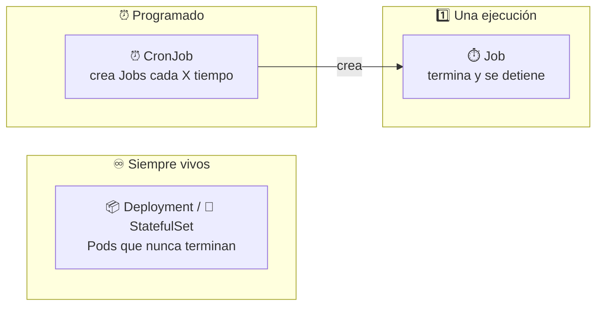
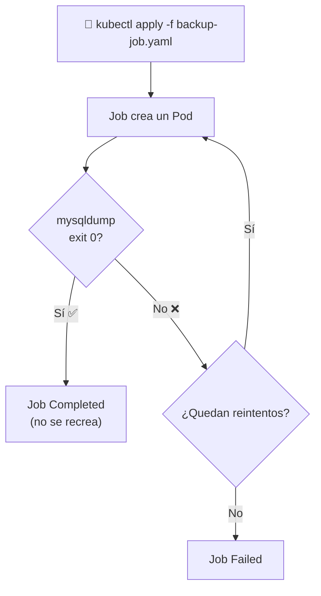
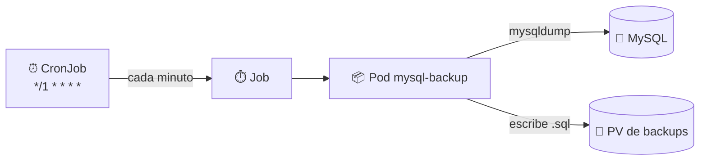
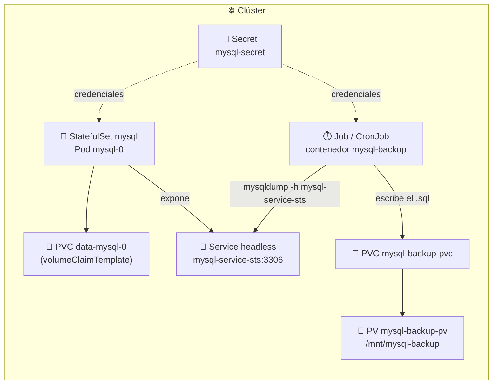

# ⏱️ Jobs y CronJobs

> Un **Deployment** mantiene Pods vivos **para siempre**; un **StatefulSet** hace lo mismo pero con identidad estable. Sin embargo, hay tareas que no deben quedarse corriendo: una migración de base de datos, un backup, un reporte. Para eso existen los **Job** (se ejecutan hasta terminar) y los **CronJob** (crean Jobs según un horario).

En este módulo montamos un **MySQL** con StatefulSet y le añadimos **backups**: primero manuales con un Job y luego automáticos con un CronJob.

## 🧠 ¿Para qué sirven?

| Necesitas... | Usa |
|--------------|:---:|
| Una app web/API siempre disponible (N réplicas) | 📦 **Deployment** |
| Una base de datos con identidad y datos estables | 💠 **StatefulSet** |
| Ejecutar una tarea **una vez** y que termine | ⏱️ **Job** |
| Ejecutar esa tarea **cada cierto tiempo** | ⏰ **CronJob** |



> 🔑 Diferencia clave: un Deployment **recrea** el Pod si termina; un Job lo considera **éxito** y no lo vuelve a crear.

## 🧩 Job

Un **Job** garantiza que una tarea se ejecute hasta completarse. Crea uno o varios Pods y lleva la cuenta de cuántos terminaron con éxito.

### Campos importantes

| Campo | Default | Qué hace |
|-------|:---:|----------|
| `completions` | `1` | Ejecuciones exitosas necesarias para dar el Job por terminado |
| `parallelism` | `1` | Cuántos Pods corren **a la vez** |
| `backoffLimit` | `6` | Reintentos antes de marcar el Job como **Failed** |
| `restartPolicy` | — | **Obligatorio**: `Never` (Pod nuevo) u `OnFailure` (mismo Pod) |
| `activeDeadlineSeconds` | — | Tiempo máximo total; si se pasa, el Job falla |
| `ttlSecondsAfterFinished` | — | Borra el Job automáticamente N segundos después de terminar |

### Ciclo de vida



> 📌 En este módulo: [`backup-job.yaml`](backup-job.yaml) hace un `mysqldump` de MySQL y guarda el `.sql` en un volumen persistente.

## ⏰ CronJob

Un **CronJob** es un Job con **horario**. Cada vez que se cumple la programación, crea un Job (y este, a su vez, un Pod).

### Sintaxis cron (5 campos)

| Campo | Valores | Ejemplo |
|-------|---------|---------|
| Minuto | `0-59` | `*/5` → cada 5 minutos |
| Hora | `0-23` | `3` → a las 03:00 |
| Día del mes | `1-31` | `1` → día 1 |
| Mes | `1-12` | `*` → todos |
| Día de la semana | `0-7` (0 y 7 = domingo) | `1` → lunes |

| Expresión | Significado |
|-----------|-------------|
| `*/1 * * * *` | Cada minuto (el que usamos para practicar) |
| `*/5 * * * *` | Cada 5 minutos |
| `0 * * * *` | Cada hora en punto |
| `0 3 * * *` | Todos los días a las 03:00 |
| `0 3 * * 0` | Todos los domingos a las 03:00 |
| `0 0 1 * *` | El día 1 de cada mes a medianoche |

### Campos importantes

| Campo | Qué hace |
|-------|----------|
| `schedule` | Expresión cron |
| `concurrencyPolicy` | `Allow` (default), `Forbid` (no solapar) o `Replace` (matar el anterior) |
| `startingDeadlineSeconds` | Margen para lanzar un Job si se perdió el horario |
| `successfulJobsHistoryLimit` | Cuántos Jobs exitosos conserva (`3` por defecto) |
| `failedJobsHistoryLimit` | Cuántos Jobs fallidos conserva (`1` por defecto) |
| `suspend` | `true` para pausar la programación |
| `timeZone` | Zona horaria del `schedule` (Kubernetes ≥ 1.27; por defecto **UTC** del controlador) |



> 📌 En este módulo: [`backup-cronjob.yaml`](backup-cronjob.yaml) programa el mismo backup **cada minuto** (solo para verlo funcionar).

## 🗺️ Arquitectura del ejemplo



| Archivo | Recursos que crea |
|---------|-------------------|
| [`mysql-secret.yaml`](mysql-secret.yaml) | `Secret` con las credenciales de MySQL |
| [`mysql-sts.yaml`](mysql-sts.yaml) | `StatefulSet` + `Service` headless (+ `PV` opcional comentado) |
| [`backup-job.yaml`](backup-job.yaml) | `Job` + `PVC` + `PV` del backup |
| [`backup-cronjob.yaml`](backup-cronjob.yaml) | `CronJob` + `PVC` (reutiliza el PV del Job) |

## 🚀 Práctica paso a paso

> 💡 Los comandos usan sintaxis **Bash** (Git Bash / WSL / Linux). En PowerShell cambia `$(...)`, `export` y las variables por su equivalente.

### 1️⃣ Crear el Secret

```bash
kubectl apply -f mysql-secret.yaml
kubectl get secret mysql-secret
```

Si quieres regenerar los valores en base64:

```bash
echo -n "rootpassword" | base64
echo -n "mydb" | base64
echo -n "myuser" | base64
echo -n "mypassword" | base64
```

> 🔐 Un Secret **no cifra**: solo codifica en base64. Cualquiera con acceso al clúster puede leerlo. En producción usa cifrado en reposo, RBAC y, si puedes, un gestor externo (Vault, Sealed Secrets, SOPS).

### 2️⃣ Desplegar MySQL

```bash
kubectl apply -f mysql-sts.yaml

kubectl get sts,pods,pvc,svc
kubectl wait --for=condition=Ready pod/mysql-0 --timeout=180s
```

Deberías ver `mysql-0` en `Running`, su PVC `data-mysql-0` en `Bound` y el Service `mysql-service-sts` con `CLUSTER-IP: None` (headless).

Crea algunos datos de prueba:

```bash
kubectl exec -it mysql-0 -- mysql -u root -p
# contraseña: rootpassword
```

```sql
SHOW DATABASES;
USE mydb;
CREATE TABLE clientes (id INT PRIMARY KEY, nombre VARCHAR(50));
INSERT INTO clientes VALUES (1, 'Ana'), (2, 'Luis');
SELECT * FROM clientes;
EXIT;
```

### 3️⃣ Ejecutar el backup manual (Job)

```bash
kubectl apply -f backup-job.yaml
kubectl get jobs
kubectl get pods -l job-name=mysql-backup
kubectl logs -l job-name=mysql-backup
```

Comprueba que el archivo se escribió en el volumen:

```bash
POD=$(kubectl get pods -l job-name=mysql-backup -o jsonpath='{.items[0].metadata.name}')
kubectl exec -it "$POD" -- ls -l /backup
```

Deberías ver algo como `mysql-backup-20261023.sql`.

> 💡 El Job pasa a `Completed`. Si lo vuelves a aplicar no se re-ejecuta: para relanzarlo bórralo primero (`kubectl delete job mysql-backup`).

### 4️⃣ Programar el backup (CronJob)

> ⚠️ El CronJob define el **PVC** pero **no el PV**. El PV `mysql-backup-pv` lo creó el paso anterior (`backup-job.yaml`). Si aún no lo aplicaste, hazlo antes; si no, el PVC quedará en `Pending`.

```bash
kubectl apply -f backup-cronjob.yaml

kubectl get cronjob
kubectl get jobs -w        # verás un Job nuevo cada minuto
```

Lanza uno a mano sin esperar al horario:

```bash
kubectl create job --from=cronjob/mysql-backup mysql-backup-manual
kubectl logs -l job-name=mysql-backup-manual
```

> ⏱️ El horario se evalúa en **UTC** por defecto. Para las 03:00 de Bogotá (UTC-5) usa `0 8 * * *`, o indica `timeZone: America/Bogota` si tu clúster es ≥ 1.27.

### 5️⃣ Verificar todo

```bash
kubectl get all
kubectl get pv,pvc
kubectl get cronjob,jobs,pods
```

### 6️⃣ Limpieza

```bash
kubectl delete cronjob mysql-backup
kubectl delete job mysql-backup
kubectl delete sts mysql
kubectl delete svc mysql-service-sts
kubectl delete pvc mysql-backup-pvc data-mysql-0
kubectl delete pv mysql-backup-pv
kubectl delete secret mysql-secret
```

> 💡 Borrar el StatefulSet **no** borra su PVC (`data-mysql-0`): es una protección para no perder datos. Hay que eliminarlo a mano. El PV dinámico se borra según su `reclaimPolicy` (`Delete` por defecto en `hostpath`); el PV manual del backup usa `Retain`, así que hay que borrarlo explícitamente.

## ⚠️ Notas y troubleshooting

| Síntoma | Causa probable | Solución |
|---------|----------------|----------|
| PVC del CronJob en `Pending` | No existe el PV `mysql-backup-pv` | Aplica antes `backup-job.yaml` (o crea el PV) |
| `mysql-0` en `Pending` / `CrashLoopBackOff` | El PVC no enlaza o MySQL tarda en inicializar | `kubectl describe pod mysql-0` y `kubectl logs mysql-0` |
| No resuelve `mysql-0.mysql-service-sts` | `serviceName` del StatefulSet no coincide con el Service | Ver nota de abajo |
| El CronJob no se dispara | Horario en UTC o CronJob `suspend: true` | Revisa `kubectl get cronjob -o yaml` |
| El Job no termina | `mysqldump` no conecta con MySQL | `kubectl logs -l job-name=mysql-backup` |

> ⚠️ **Detalle del manifiesto**: [`mysql-sts.yaml`](mysql-sts.yaml) declara `serviceName: mysql-service`, pero el Service se llama `mysql-service-sts`. La conexión a `mysql-service-sts` **sí funciona** (el Service selecciona el Pod por label), pero para que la **DNS estable** del StatefulSet (`mysql-0.mysql-service-sts`) sea consistente, ambos nombres deberían coincidir. Se dejó el valor original para no alterar el ejercicio.

> ⚠️ **`mysqldump -p$(PASSWORD)`** deja la contraseña visible en la lista de procesos del contenedor. En producción usa la variable `MYSQL_PWD` o un `--defaults-extra-file` con permisos restringidos.

> ⚠️ **`hostPath` no es un backup de verdad**: el `.sql` queda en el nodo. Si el nodo muere, se pierde. Para producción usa almacenamiento de red (NFS) u object storage (S3, GCS) o una herramienta como **Velero**.

> 💡 **`ttlSecondsAfterFinished`** es muy útil en Jobs: añade, por ejemplo, `ttlSecondsAfterFinished: 100` y Kubernetes borra el Job (y sus Pods) 100 segundos después de terminar, sin acumular basura.

> 💡 **Los Jobs no son idempotentes por sí solos**: si el comando escribe un archivo con la fecha del día, dos ejecuciones el mismo día se sobrescriben. El CronJob usa fecha **y hora** (`%Y%m%d_%H%M`) justo para evitarlo.

## 🧭 Navegación

- 🧱 [Módulo anterior: App multi-tier](../13-multi-tier/README.md)
- ↩️ [Inicio del curso](../README.md)

---

🧠 *Resumen del módulo "Jobs y CronJobs" del curso de Platzi.*
