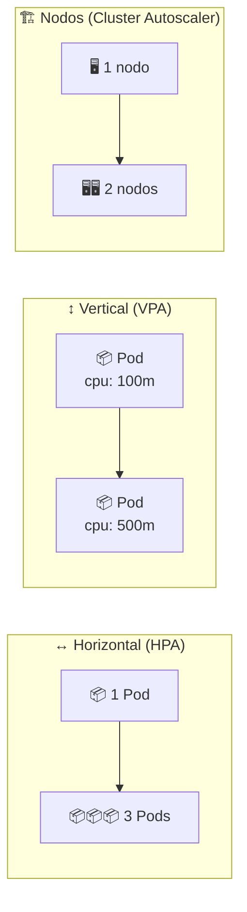

# 📈 Autoscaling: HPA y VPA

> Hasta ahora los Deployments tenían un número **fijo** de réplicas. En producción la carga sube y baja: de noche sobra capacidad y a mediodía falta. Kubernetes resuelve eso con **autoescalado**, y aquí verás las dos variantes que se aplican a *Pods*: **HPA** (más réplicas) y **VPA** (réplicas más grandes).

## 🗺️ Las tres dimensiones del escalado



| Necesitas... | Usa | Quién lo hace |
|--------------|:---:|---------------|
| Más **réplicas** del mismo Pod | ↔️ **HPA** | El controlador del HPA + el Deployment |
| Más **recursos** para un Pod | ↕️ **VPA** | El *recommender* y el *updater* del VPA |
| Más **nodos** en el clúster | 🏗️ **Cluster Autoscaler** | El proveedor de nube (AWS, GCP, Azure…) |

| | HPA | VPA |
|---|---|---|
| Escala | **Cantidad** de Pods | **Tamaño** de cada Pod (requests/limits) |
| Disrupción | Ninguna: crea Pods nuevos en caliente | Reinicia el Pod para aplicar los recursos nuevos |
| Métricas | CPU, memoria y métricas custom | Uso histórico de CPU/memoria |
| Requisito | `requests` definidos + metrics-server | Idem + CRDs del VPA |
| API | `autoscaling/v2` (nativo) | `autoscaling.k8s.io/v1` (**no** viene instalada) |

> ⚠️ **Cluster Autoscaler no se puede practicar en local**: necesita un proveedor de nube que sepa crear VMs. Ni minikube ni Docker Desktop lo traen. En este módulo practicamos HPA y VPA; el tercero queda como concepto.

## ⚙️ Requisitos según tu entorno

El curso se ha hecho en dos entornos distintos y **no son intercambiables**: lo que es un addon de minikube en Docker Desktop hay que instalarlo a mano, y viceversa.

| Acción | 🐳 **minikube** (Ubuntu) | 🖥️ **Docker Desktop** (Windows 11) |
|--------|--------------------------|-----------------------------------|
| Crear el clúster | `minikube start --driver=docker` | Ajustes → *Kubernetes* → *Enable Kubernetes* |
| Contexto de kubectl | `minikube` | `docker-desktop` |
| Ver el contexto activo | `kubectl config current-context` | `kubectl config current-context` |
| **metrics-server** | `minikube addons enable metrics-server` | **no viene**: `kubectl apply -f https://github.com/kubernetes-sigs/metrics-server/releases/latest/download/components.yaml` |
| Imágenes locales | **Ruta A**: `minikube image build -t backend:latest ./backend` | **Ruta B**: `docker build -t backend:latest ./backend` (el clúster comparte el almacén de imágenes) |
| Navegador para un Service | `minikube service <svc>` o `minikube tunnel` | ya responde en `http://localhost:<puerto>` |
| Dashboard | `minikube dashboard` | la UI de Docker Desktop |
| Entrar al nodo | `minikube ssh` | no aplica: el nodo lo gestiona Docker Desktop |

> 💡 Todos los comandos de este módulo son de **kubectl** salvo dos excepciones explícitamente marcadas: el addon de **metrics-server** y el **build de imágenes** (bloques `🐳 minikube`).

### Por qué hace falta metrics-server

El HPA no inventa números: los pide a la **Metrics API**, que sirve `metrics-server` leyendo el kubelet de cada nodo. Sin él:

- `kubectl top pods` → `error: Metrics API not available`
- `kubectl get hpa` → `TARGETS: <unknown>/20%`

Verifícalo así:

```bash
kubectl top nodes          # CPU/RAM del nodo
kubectl top pods           # CPU/RAM de cada Pod
```

## 🚀 Demo 1: HPA sobre nginx

Los manifiestos son deliberadamente extremos: piden **1m de CPU** (una milésima de núcleo) para que cualquier petición supere el 20 % objetivo y el escalado se vea en segundos.

| Archivo | Qué crea |
|---------|----------|
| [`app.yaml`](app.yaml) | `Deployment` `my-app-deployment` (2 réplicas, `nginx:1.14.2`) + `Service` ClusterIP `my-app-service` |
| [`hpa.yaml`](hpa.yaml) | `HorizontalPodAutoscaler` `my-hpa` → 1..4 réplicas al **20 % de CPU** |
| [`vpa.yaml`](vpa.yaml) | `VerticalPodAutoscaler` `my-vpa` (opcional, ver más abajo) |

```bash
kubectl apply -f app.yaml
kubectl apply -f hpa.yaml

kubectl get pods -l app=nginx
kubectl get hpa
```

### Qué vas a ver (y cuánto tarda)

`TARGETS` empieza en `<unknown>`: el HPA necesita que metrics-server tenga al menos una muestra de los Pods. En este clúster tardó **~2 minutos**:

```text
NAME     REFERENCE                      TARGETS              MINPODS   MAXPODS   REPLICAS
my-hpa   Deployment/my-app-deployment   cpu: <unknown>/20%   1         4         2
```

y después:

```text
NAME     REFERENCE                      TARGETS       MINPODS   MAXPODS   REPLICAS
my-hpa   Deployment/my-app-deployment   cpu: 0%/20%   1         4         2
```

> 🔍 El porcentaje es siempre **relativo al `requests` del contenedor**, no al uso del nodo: `1m × 20 % = 0,2m`. Por eso este demo escala con nada de tráfico. Con `requests: 100m` y objetivo 80 %, haría falta mucha más carga (es lo que hace la [demo de la app real](curso-de-docker-fundamentos/README.md)).

### Generar carga

```bash
kubectl run load-generator --image=busybox:1.36 --restart=Never -- \
  /bin/sh -c "while sleep 0.001; do wget -q -O- http://my-app-service; done"

# en otra terminal
watch -n 5 kubectl get hpa,pods
```

En ~40 segundos el HPA decide escalar:

```text
NAME     REFERENCE                      TARGETS      MINPODS   MAXPODS   REPLICAS
my-hpa   Deployment/my-app-deployment   cpu: 50%/20%   1         4         4
```

```text
Normal  SuccessfulRescale  New size: 4; reason: cpu resource utilization (percentage of request) above target
```

Ese evento (y no el `kubectl get`) es la prueba de que **es el HPA** el que cambió el número de réplicas:

```bash
kubectl describe hpa my-hpa | sed -n '/Events/,$p'
```

### Volver al estado inicial

```bash
kubectl delete pod load-generator
```

El descenso **no es inmediato**: el HPA aplica una ventana de estabilización de 5 minutos (`--horizontal-pod-autoscaler-downscale-stabilization`) para no oscilar entre escalar y desescalar con cada bache de tráfico. Mientras dura, el estado lo dice claramente:

```bash
kubectl describe hpa my-hpa | grep -A2 Conditions
# AbleToScale  True  ScaleDownStabilized  recent recommendations were higher than current one…
```

En la práctica del curso tardó **unos 10 minutos** en volver a `minReplicas: 1` (la ventana de 5 min más el retraso con el que llegan las métricas). No es un error: es el freno anti-oscilación.

> 💡 El HPA nunca baja de `minReplicas` ni pasa de `maxReplicas`, aunque las métricas digan otra cosa. Y si quieres ver el ciclo completo: `kubectl get hpa -w`.

## 🧱 VPA (opcional, requiere instalar CRDs)

El VPA **no** es un recurso nativo: hay que instalar sus CRDs y sus tres componentes (`recommender`, `updater`, `admission-controller`). No hay addon ni en minikube ni en Docker Desktop, así que el procedimiento es el mismo en ambos:

```bash
git clone https://github.com/kubernetes/autoscaler.git
cd autoscaler/vertical-pod-autoscaler
./hack/vpa-up.sh
```

```bash
kubectl get pods -n kube-system | grep vpa
kubectl api-resources | grep verticalpodautoscalers
```

> 🔐 Si el script falla creando los secretos del admission controller, el propio repo trae el generador de certificados:
> ```bash
> bash ./pkg/admission-controller/gencerts.sh
> ```

Aplicar el manifiesto del módulo y leer la recomendación:

```bash
kubectl apply -f vpa.yaml
kubectl get vpa
kubectl describe vpa my-vpa
```

| `updateMode` | Qué hace |
|--------------|----------|
| `Off` | Solo **recomienda**: no toca nada. Ideal para observar |
| `Initial` | Aplica los recursos solo al crear el Pod |
| `Recreate` | Reinicia los Pods con los recursos nuevos |
| `Auto` | En la práctica, igual que `Recreate` |

> ⚠️ **No pongas HPA y VPA a la vez sobre el mismo Deployment con las mismas métricas**: el HPA añade réplicas al ver CPU alta y el VPA sube el `requests`, con lo que el HPA deja de verla alta y reduce… y vuelven a empezar. Aquí `my-hpa` y `my-vpa` apuntan al mismo Deployment: usa `updateMode: "Off"` mientras estudias el VPA, o aplica el VPA a otro Deployment.

> 💡 Los valores de [`vpa.yaml`](vpa.yaml) son de juguete (`minAllowed: 1m/4Mi`, `maxAllowed: 8m/32Mi`). Sirven para ver cómo cambia el `requests` del Pod sin esperar a métricas reales.

## 🔬 Demo 2: escalar la app multi-tier

La segunda parte del módulo aplica todo esto a una app de verdad (Flask + nginx, la misma del [módulo 13](../13-multi-tier/README.md)) con dos HPAs de umbrales realistas:

| HPA | Deployment | Objetivo |
|-----|------------|----------|
| `backend-hpa` | `backend-deployment` | 80 % de CPU, 1..5 réplicas |
| `frontend-hpa` | `frontend-deployment` | 20 % de CPU, 1..3 réplicas |

Pasos completos en **[curso-de-docker-fundamentos/README.md](curso-de-docker-fundamentos/README.md)**.

> ⚠️ **Antes de mirar el HPA, comprueba que los Pods estén `Running`.** Esta app usa `imagePullPolicy: Never`, así que la imagen tiene que estar dentro del nodo: **ruta A** (`minikube image build`) o **ruta B** (`docker build`), las dos en el paso 1 del demo. Si en minikube construyes con `docker compose build`, el Pod queda en `ErrImagePull` y el HPA en `TARGETS: <unknown>`: sin Pods no hay métricas.

## 🧯 Troubleshooting

| Síntoma | Causa probable | Solución |
|---------|----------------|----------|
| `TARGETS: <unknown>/20%` en los primeros minutos | metrics-server aún no tiene muestras de esos Pods | Espera 1–3 min; si sigue, revisa el evento del HPA |
| `TARGETS: <unknown>` permanente + `FailedGetResourceMetric` | metrics-server no instalado o no listo | `kubectl get pods -n kube-system \| grep metrics-server` (minikube: `minikube addons enable metrics-server`) |
| `error: Metrics API not available` | Sin Metrics API | Igual que el anterior |
| `x509: cannot validate certificate for … because it doesn't contain any IP SANs` | metrics-server no confía en el certificado del kubelet | Añade `--kubelet-insecure-tls` al Deployment de metrics-server |
| El HPA no escala aunque haya carga | El contenedor no tiene `resources.requests.cpu` | Sin `requests`, la utilización se calcula sobre 0 y no hay porcentaje posible |
| El HPA se queda en `REPLICAS: 4` y la app va lenta | Límite de CPU de 1m en `app.yaml` (demo) | Sube los `resources` o usa la demo 2 |
| `no matches for kind "VerticalPodAutoscaler"` | Faltan las CRDs del VPA | `./hack/vpa-up.sh` |
| `minikube: command not found` en Windows | Ese flujo es de minikube; tu clúster es Docker Desktop | Usa solo `kubectl` (y `docker build`) |

> 🔍 El evento del HPA es la mejor pista: `kubectl describe hpa my-hpa` muestra `FailedGetResourceMetric`, `FailedComputeMetricsReplicas` o `SuccessfulRescale` con la razón exacta.

## 🧹 Limpieza

```bash
kubectl delete -f app.yaml -f hpa.yaml
kubectl delete -f vpa.yaml --ignore-not-found

# minikube: si ya no lo necesitas
minikube addons disable metrics-server
```

## 🧭 Navegación

- ⏱️ [Módulo anterior: Jobs y CronJobs](../14-jobs-cronjobs/README.md)
- 📚 [Inicio del curso](../README.md)

---

🧠 *Resumen del módulo "Autoscaling" del curso de Platzi: HPA, VPA y la diferencia entre escalar Pods y escalar nodos.*
