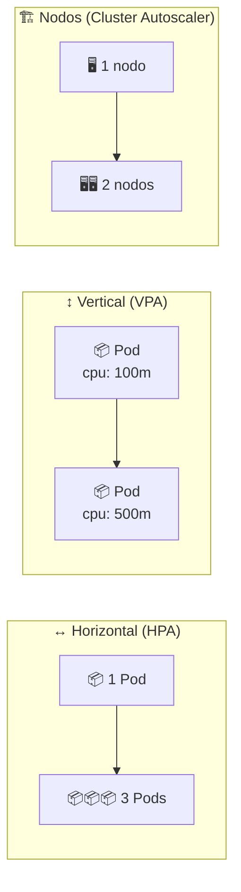

# 📈 Autoscaling: HPA y VPA

> Hasta ahora los Deployments tenían un número **fijo** de réplicas. En producción la carga sube y baja: de noche sobra capacidad y a mediodía falta. Kubernetes resuelve eso con **autoescalado**, y aquí verás las dos variantes que se aplican a *Pods*: **HPA** (más réplicas) y **VPA** (réplicas más grandes).

## 🗺️ Las tres dimensiones del escalado



| Necesitas... | Usa | Quién lo hace |
|--------------|:---:|---------------|
| Más **réplicas** del mismo Pod | ↔️ **HPA** | El controlador del HPA + el Deployment |
| Más **recursos** para un Pod | ↕️ **VPA** | El *recommender* y el *updater* del VPA |
| Más **nodos** en el clúster | 🏗️ **Cluster Autoscaler** | El proveedor de nube (AWS, GCP, Azure…) |

| | HPA | VPA |
|---|---|---|
| Escala | **Cantidad** de Pods | **Tamaño** de cada Pod (requests/limits) |
| Disrupción | Ninguna: crea Pods nuevos en caliente | Reinicia el Pod para aplicar los recursos |
| Métricas | CPU, memoria y métricas custom | Uso histórico de CPU/memoria |
| Requisito | `requests` definidos + metrics-server | Idem + CRDs del VPA |
| API | `autoscaling/v2` (nativo) | `autoscaling.k8s.io/v1` (**no** viene instalada) |

> ⚠️ **Cluster Autoscaler no se puede practicar en local**: necesita un proveedor de nube que sepa crear VMs. Ni minikube ni Docker Desktop lo traen.

## 📁 Archivos del módulo

| Archivo | Qué crea |
|---------|----------|
| [`manifests/00-namespace.yaml`](manifests/00-namespace.yaml) | Namespace `autoscaling` (aísla el módulo del resto del curso) |
| [`manifests/deployment.yaml`](manifests/deployment.yaml) | Deployment `my-app` (`nginx:1.14.2`, 2 réplicas, probes y `requests` de 1m) |
| [`manifests/service.yaml`](manifests/service.yaml) | Service `my-app` (ClusterIP, puerto con nombre `http`) |
| [`manifests/hpa.yaml`](manifests/hpa.yaml) | HPA `my-app` → 1..4 réplicas al **20 % de CPU**, con `behavior` explícito |
| [`manifests/pdb.yaml`](manifests/pdb.yaml) | PDB `my-app` → `maxUnavailable: 1` (protege los drenados del nodo) |
| [`manifests/optional/vpa.yaml`](manifests/optional/vpa.yaml) | VPA `my-app` (opcional: necesita CRDs) |
| [`curso-de-docker-fundamentos/`](curso-de-docker-fundamentos/README.md) | Demo 2: la app del módulo 13 + dos HPAs |

> 🗂️ `optional/` está en una subcarpeta a propósito: `kubectl apply -f manifests/` **no** entra en subdirectorios, así que el VPA nunca se aplica sin querer (fallaría sin las CRDs).

## ⚙️ Requisitos según tu entorno

El curso se ha hecho en dos entornos y **no son intercambiables**:

| Acción | 🐳 **minikube** (Ubuntu) | 🖥️ **Docker Desktop** (Windows 11) |
|--------|--------------------------|-----------------------------------|
| Crear el clúster | `minikube start --driver=docker` | Ajustes → *Kubernetes* → *Enable Kubernetes* |
| Contexto de kubectl | `minikube` | `docker-desktop` |
| **metrics-server** | `minikube addons enable metrics-server` | **no viene**: `kubectl apply -f https://github.com/kubernetes-sigs/metrics-server/releases/latest/download/components.yaml` |
| Imágenes locales | **Ruta A**: `minikube image build` | **Ruta B**: `docker build` (el clúster comparte el almacén) |
| Navegador para un Service | `minikube service <svc>` o `minikube tunnel` | ya responde en `http://localhost:<puerto>` |
| Dashboard | `minikube dashboard` | la UI de Docker Desktop |
| Entrar al nodo | `minikube ssh` | no aplica: el nodo lo gestiona Docker Desktop |

> 💡 Todo lo de este módulo es `kubectl` salvo dos excepciones marcadas: **metrics-server** y el **build de imágenes** de la Demo 2.

### Por qué hace falta metrics-server

El HPA no inventa números: los pide a la **Metrics API**, que sirve `metrics-server` leyendo el kubelet de cada nodo. Sin él:

- `kubectl top pods` → `error: Metrics API not available`
- `kubectl get hpa` → `TARGETS: <unknown>/20%`

```bash
kubectl top nodes          # CPU/RAM del nodo
kubectl top pods           # CPU/RAM de cada Pod
```

## 🚀 Demo 1: HPA sobre nginx

Los manifiestos son deliberadamente extremos: piden **1m de CPU** (una milésima de núcleo) para que cualquier petición supere el 20 % objetivo y el escalado se vea en segundos.

### Desplegar

```bash
kubectl apply -f manifests/

# todo el módulo vive en su propio namespace: déjalo seleccionado
kubectl config set-context --current --namespace=autoscaling

kubectl get pods,svc,hpa,pdb
```

El prefijo `00-` del namespace no es decorativo: kubectl aplica los archivos de una carpeta en orden alfabético, así que el Namespace se crea antes que sus objetos.

### Qué vas a ver (y cuánto tarda)

`TARGETS` empieza en `<unknown>`: el HPA necesita que metrics-server tenga al menos una muestra de los Pods. En este clúster tardó **~2 minutos**:

```text
NAME     REFERENCE         TARGETS              MINPODS   MAXPODS   REPLICAS
my-app   Deployment/my-app cpu: <unknown>/20%   1         4         2
```

y después:

```text
NAME     REFERENCE         TARGETS       MINPODS   MAXPODS   REPLICAS
my-app   Deployment/my-app cpu: 0%/20%   1         4         2
```

> 🔍 El porcentaje es siempre **relativo al `requests` del contenedor**, no al uso del nodo: `1m × 20 % = 0,2m`. Por eso este demo escala con nada de tráfico. Con `requests: 100m` y objetivo 80 % haría falta mucha más carga (es lo que hace la [Demo 2](curso-de-docker-fundamentos/README.md)).

### Generar carga

```bash
kubectl run load-generator --image=busybox:1.36 --restart=Never -- \
  /bin/sh -c "while sleep 0.001; do wget -q -O- http://my-app; done"

# en otra terminal
watch -n 5 kubectl get hpa,pods
```

En ~40 segundos el HPA decide escalar:

```text
NAME     REFERENCE         TARGETS      MINPODS   MAXPODS   REPLICAS
my-app   Deployment/my-app cpu: 50%/20%   1         4         4
```

```text
Normal  SuccessfulRescale  New size: 4; reason: cpu resource utilization (percentage of request) above target
```

Ese evento (y no el `kubectl get`) es la prueba de que **es el HPA** el que cambió el número de réplicas:

```bash
kubectl describe hpa my-app | sed -n '/Events/,$p'
```

### El `behavior` del HPA

`manifests/hpa.yaml` declara explícitamente lo que antes dependía de los valores por defecto:

```yaml
behavior:
  scaleUp:
    stabilizationWindowSeconds: 0     # subir rápido
    policies: [{type: Percent, value: 100, periodSeconds: 30}]
  scaleDown:
    stabilizationWindowSeconds: 300   # bajar lento (5 min)
```

### Volver al estado inicial

```bash
kubectl delete pod load-generator
```

El descenso **no es inmediato**: se respeta la ventana de `scaleDown` (5 minutos) para no oscilar con cada bache de tráfico. Mientras dura:

```bash
kubectl describe hpa my-app | grep -A2 Conditions
# AbleToScale  True  ScaleDownStabilized  recent recommendations were higher…
```

En la práctica del curso tardó **~10 minutos** en volver a `minReplicas: 1` (la ventana de 5 min más el retraso de las métricas).

## 🧱 VPA (opcional, requiere instalar CRDs)

El VPA **no** es un recurso nativo: hay que instalar sus CRDs y sus tres componentes. No hay addon ni en minikube ni en Docker Desktop, así que el procedimiento es el mismo en ambos:

```bash
git clone https://github.com/kubernetes/autoscaler.git
cd autoscaler/vertical-pod-autoscaler
./hack/vpa-up.sh
```

```bash
kubectl get pods -n kube-system | grep vpa
kubectl api-resources | grep verticalpodautoscalers
```

Aplicar el manifiesto del módulo y leer la recomendación:

```bash
kubectl apply -f manifests/optional/vpa.yaml
kubectl get vpa
kubectl describe vpa my-app
```

| `updateMode` | Qué hace |
|--------------|----------|
| `Off` | Solo **recomienda**: no toca nada (el que usa este módulo) |
| `Initial` | Aplica los recursos solo al crear el Pod |
| `Recreate` | Reinicia los Pods con los recursos nuevos |
| `Auto` | En la práctica, igual que `Recreate` |

### ⚠️ HPA y VPA sobre el mismo Deployment

Los dos apuntan a `my-app`, y mueven palancas que se afectan entre sí:

| Objeto | Qué cambia | Efecto cruzado |
|--------|------------|----------------|
| HPA | `replicas` | Calcula `uso / requests`; si el request sube, el % baja → **quita réplicas** |
| VPA (`Auto`) | `requests.cpu` | Al subirlo, el HPA cree que sobra capacidad → **baja réplicas** |

Resultado: un péndulo (y reinicios de Pods cada vez que el VPA ajusta). Por eso el manifiesto usa `updateMode: "Off"`.

| Alternativa | Configuración | Qué se ve |
|-------------|---------------|-----------|
| **A. Solo recomendar** ✅ (la del módulo) | `updateMode: "Off"` | `describe vpa` muestra la recomendación, sin reinicios |
| **B. Repartir métricas** | VPA `controlledResources: ["memory"]` + HPA en CPU | El VPA sí actúa, el HPA mantiene CPU estable |
| **C. Deployments separados** | VPA sobre otro Deployment sin HPA | Se enseña el VPA de verdad, sin mezclar |

## 🛡️ PDB: proteger los Pods en mantenimientos

[`manifests/pdb.yaml`](manifests/pdb.yaml) limita cuántos Pods pueden desalojarse **a la vez** en las interrupciones *voluntarias*:

| Protege de | **No** protege de |
|---|---|
| `kubectl drain` | crash del Pod (`CrashLoopBackOff`) |
| actualizaciones / evacuación del nodo | `OOMKilled` |
| mantenimiento del cloud | `kubectl delete pod` o nodo caído |

```bash
kubectl get pdb
kubectl describe pdb my-app
```

> ⚠️ Se usa `maxUnavailable: 1` y **no** `minAvailable: 1`: con una sola réplica, `minAvailable: 1` bloquea `kubectl drain` para siempre (no hay nodo donde reubicar el único Pod).

## 🔬 Demo 2: escalar la app multi-tier

La segunda parte del módulo aplica todo esto a una app real (Flask + nginx, la misma del [módulo 13](../13-multi-tier/README.md)) con dos HPAs de umbrales realistas:

| HPA | Deployment | Objetivo |
|-----|------------|----------|
| `backend-hpa` | `backend-deployment` | 80 % de CPU, 1..5 réplicas |
| `frontend-hpa` | `frontend-deployment` | 20 % de CPU, 1..3 réplicas |

Pasos completos en **[curso-de-docker-fundamentos/README.md](curso-de-docker-fundamentos/README.md)**.

## ✅ Buenas prácticas aplicadas en este módulo

| Práctica | Dónde | Por qué |
|----------|-------|---------|
| Labels estándar `app.kubernetes.io/*` | Todos los objetos | Permiten filtrar y agrupar (`kubectl get all -l app.kubernetes.io/part-of=curso-kubernetes`) |
| Puerto con nombre + `targetPort: http` | Services y Pods | El Service deja de depender del número de puerto del contenedor |
| `readinessProbe` / `livenessProbe` | Deployments | Sin readiness, el HPA cuenta Pods que no responden y el Service les manda tráfico |
| `revisionHistoryLimit: 3` | Deployments | No acumular ReplicaSets de rollouts viejos |
| `minReadySeconds` / `progressDeadlineSeconds` | Deployments | Rollouts predecibles y con límite de tiempo |
| `automountServiceAccountToken: false` | Pods | La app no habla con la API: no le des token |
| `behavior` explícito | HPAs | Deja escrito el freno de bajada en vez de depender del default |
| `PodDisruptionBudget` | `pdb.yaml` | Un drain no se lleva todas las réplicas a la vez |
| Namespace propio | `00-namespace.yaml` | Evita chocar con los recursos del módulo 13 |

> 🧭 **Deuda consciente** (para una siguiente iteración, no para este módulo): `LoadBalancer` en vez de `ClusterIP` + Ingress; `nginx:1.14.2` está EOL; `securityContext` con `runAsNonRoot`/`readOnlyRootFilesystem` requiere la imagen `nginx-unprivileged`; y los `requests` de 1m son solo para la demo.

## 🧯 Troubleshooting

| Síntoma | Causa probable | Solución |
|---------|----------------|----------|
| `error: the server doesn't have a resource type "hpa"` o `NotFound` | Estás en otro namespace | `kubectl config set-context --current --namespace=autoscaling` o añade `-n autoscaling` |
| `TARGETS: <unknown>/20%` en los primeros minutos | metrics-server aún no tiene muestras de esos Pods | Espera 1–3 min; si sigue, mira el evento del HPA |
| `TARGETS: <unknown>` permanente + `FailedGetResourceMetric` | metrics-server no instalado o no listo | `kubectl get pods -n kube-system \| grep metrics-server` (minikube: `minikube addons enable metrics-server`) |
| `kubectl top` → `Metrics API not available` | Sin Metrics API | Igual que el anterior |
| `x509: cannot validate certificate for …` | metrics-server no confía en el certificado del kubelet | Añade `--kubelet-insecure-tls` al Deployment de metrics-server |
| El HPA no escala aunque haya carga | Falta `resources.requests.cpu` en el contenedor | Revisa el `deployment.yaml` |
| El HPA se queda en `REPLICAS: 4` y la app va lenta | Límite de CPU de 1m (demo) | Sube los `resources` o usa la Demo 2 |
| `no matches for kind "VerticalPodAutoscaler"` | Faltan las CRDs del VPA | `./hack/vpa-up.sh` |
| `minikube: command not found` en Windows | Ese flujo es de minikube; tu clúster es Docker Desktop | Usa solo `kubectl` (y `docker build`) |

## 🧹 Limpieza

```bash
# borra los objetos del módulo por label (demo 1 y demo 2 comparten namespace)
kubectl delete deploy,svc,hpa,pdb -l app.kubernetes.io/part-of=curso-kubernetes --ignore-not-found
kubectl delete vpa my-app --ignore-not-found
kubectl delete pod load-generator --ignore-not-found

# el namespace vacío y volver al de siempre
kubectl delete namespace autoscaling --ignore-not-found
kubectl config set-context --current --namespace=default

# minikube: si ya no necesitas las métricas
minikube addons disable metrics-server
```

## 🧭 Navegación

- ⏱️ [Módulo anterior: Jobs y CronJobs](../14-jobs-cronjobs/README.md)
- 📚 [Inicio del curso](../README.md)

---

🧠 *Resumen del módulo "Autoscaling" del curso de Platzi: HPA, VPA y la diferencia entre escalar Pods y escalar nodos.*
