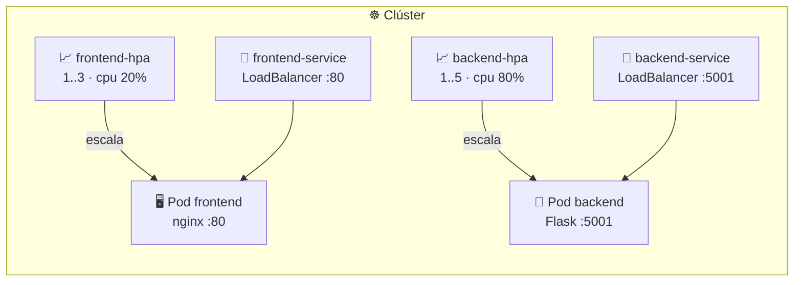

# 📈 Demo 2: escalar la app multi-tier con HPA

> Esta carpeta es la misma app del [módulo 13](../../13-multi-tier/README.md) (Flask + nginx), pero con **HorizontalPodAutoscalers** encima. Aquí no se explica qué es un HPA: eso está en el [README del módulo 15](../README.md).

## 🗺️ Qué se despliega



| Manifiesto | Recursos |
|------------|----------|
| `k8s/backend/deployment.yaml` | Deployment `backend-deployment` (`backend:latest`, 5001) |
| `k8s/backend/service.yaml` | Service `backend-service` (LoadBalancer, 5001) |
| `k8s/backend/hpa.yaml` | HPA `backend-hpa` — 1..5 réplicas al **80 %** de su `requests.cpu` (50m) |
| `k8s/frontend/deployment.yaml` | Deployment `frontend-deployment` (`frontend:latest`, 80) |
| `k8s/frontend/service.yaml` | Service `frontend-service` (LoadBalancer, 80) |
| `k8s/frontend/hpa.yaml` | HPA `frontend-hpa` — 1..3 réplicas al **20 %** de su `requests.cpu` (50m) |

## ⚙️ Requisitos según tu entorno

| Paso | 🐳 **minikube** (Ubuntu) | 🖥️ **Docker Desktop** (Windows 11) |
|------|--------------------------|-----------------------------------|
| Clúster arriba | `minikube start --driver=docker` | *Enable Kubernetes* en Ajustes |
| metrics-server | `minikube addons enable metrics-server` | `kubectl apply -f https://github.com/kubernetes-sigs/metrics-server/releases/latest/download/components.yaml` |
| Imágenes locales | **Ruta A**: `minikube image build` | **Ruta B**: `docker build` (el clúster usa el mismo almacén) |
| Abrir un Service | `minikube service frontend-service` | `http://localhost:80` |

> 💡 Comprueba en qué clúster estás antes de aplicar nada: `kubectl config current-context` → `minikube` o `docker-desktop`.

## 1️⃣ Construir las imágenes (eliges una ruta)

Las imágenes no están en Docker Hub: hay que construirlas y dejarlas donde el clúster **sí** las vea. Cada entorno tiene su camino; usa el de tu entorno y no mezcles.

### 🖥️ Ruta A — minikube (Ubuntu, la que usamos en el curso)

El nodo de minikube usa **containerd**, no tu Docker del host, así que se construye con el propio minikube:

```bash
cd curso-de-docker-fundamentos

minikube image build -t backend:latest  ./backend
minikube image build -t frontend:latest ./frontend
```

Comprueba que quedaron **dentro del clúster**:

```bash
minikube image ls --format table | grep -E "backend|frontend"
```

```text
│ docker.io/library/backend    │ latest │ sha256:22bded │ 24.9MB │
│ docker.io/library/frontend   │ latest │ sha256:323f23 │ 63.9MB │
```

### 🖥️ Ruta B — Docker Desktop (Windows 11)

Docker Desktop comparte su almacén de imágenes con el clúster, así que basta un `docker build` normal:

```bash
cd curso-de-docker-fundamentos

docker build -t backend:latest  ./backend
docker build -t frontend:latest ./frontend
```

Comprueba que existen en tu Docker:

```bash
docker images | grep -E "backend|frontend"
```

> 🔁 Si ya habías desplegado y luego reconstruiste la imagen, fuerza Pods nuevos:
> ```bash
> kubectl rollout restart deploy/backend-deployment deploy/frontend-deployment
> ```

> 💡 Los Deployments usan `imagePullPolicy: Never` porque la imagen no existe en ningún registry: se usa la que ya está en el nodo. Si la imagen no llegó al nodo → `ErrImagePull` / `ImagePullBackOff`.

## 2️⃣ Desplegar todo

```bash
kubectl apply -f k8s/backend/
kubectl apply -f k8s/frontend/

kubectl get deploy,pods,svc
kubectl get hpa

# deja que arranquen: sin Pods listos no hay métricas para el HPA
kubectl wait --for=condition=Ready pod -l app=backend  --timeout=180s
kubectl wait --for=condition=Ready pod -l app=frontend --timeout=180s
```

Esperado:

```text
NAME                                  READY   STATUS    RESTARTS   AGE
backend-deployment-6cd964975f-qfrkg   1/1     Running   0          40s
frontend-deployment-f8d97998f-k5d2m   1/1     Running   0          40s
```

Los Pods tardan unos segundos; el backend instala Flask dentro del contenedor. Si alguno queda en `ErrImagePull`, vuelve al paso 1 (la ruta de tu entorno) y repite.

## 3️⃣ Verificar que el HPA tiene métricas

```bash
kubectl top pods          # ¿hay números? entonces metrics-server funciona
kubectl get hpa
```

Esperado (los porcentajes son de ejemplo: dependen de la carga real):

| NAME | REFERENCE | TARGETS | MINPODS | MAXPODS | REPLICAS |
|------|-----------|---------|---------|---------|----------|
| `backend-hpa` | `Deployment/backend-deployment` | `cpu: 2%/80%` | 1 | 5 | 1 |
| `frontend-hpa` | `Deployment/frontend-deployment` | `cpu: 4%/20%` | 1 | 3 | 1 |

> ⏱️ Si `TARGETS` sale `<unknown>` durante el primer minuto, es normal: metrics-server todavía no tiene muestras de esos Pods. Consulta `kubectl describe hpa backend-hpa` para ver el motivo exacto.

## 4️⃣ Generar carga y ver el escalado

```bash
# en una terminal: mira cómo cambian las réplicas (el HPA no lleva labels, se mira aparte)
kubectl get hpa -w

# en otra: los Pods del frontend apareciendo y desapareciendo
kubectl get pods -l app=frontend -w
```

```bash
# en otra: carga contra el frontend (su umbral es el más bajo: 20%)
kubectl run load-generator --image=busybox:1.36 --restart=Never -- \
  /bin/sh -c "while sleep 0.001; do wget -q -O- http://frontend-service; done"
```

El evento que confirma que **es el HPA** quien escala (y no tú):

```bash
kubectl describe hpa frontend-hpa | sed -n '/Events/,$p'
# Normal  SuccessfulRescale  New size: 3; reason: cpu resource utilization (percentage of request) above target
```

Para el backend, cambia la URL a `http://backend-service:5001/getMyInfo`.

Al borrar el generador de carga (`kubectl delete pod load-generator`) las réplicas **bajan despacio**: hay una ventana de estabilización de 5 minutos (más el retraso de las métricas) para no oscilar. En la práctica puede tardar 10 minutos en volver a 1. Mientras tanto, `kubectl describe hpa` muestra `AbleToScale: True` con razón `ScaleDownStabilized`.

## 5️⃣ Probar la app en el navegador

```bash
# 🐳 minikube (Ubuntu)
minikube service frontend-service
minikube service backend-service      # o: minikube tunnel

# 🖥️ Docker Desktop (Windows 11): los LoadBalancer ya escuchan en localhost
#    http://localhost:80  y  http://localhost:5001/getMyInfo
```

> ⚠️ El JS del frontend hace `fetch('http://localhost:5001/getMyInfo')`. Funciona con `port-forward`/`minikube service`, pero **no** dentro del clúster: el detalle y las soluciones están en el módulo 13, sección *"El detalle del `localhost` en `requests.js`"*.

## 🧯 Troubleshooting

| Síntoma | Causa | Solución |
|---------|-------|----------|
| `ErrImagePull` / `ImagePullBackOff` | La imagen no llegó al nodo (típico: construir con `docker compose build` en vez de la ruta del paso 1) | Repite el paso 1 con **tu** ruta (A: `minikube image build`, B: `docker build`) y luego `kubectl rollout restart deploy/backend-deployment deploy/frontend-deployment` |
| Pods `Running` pero HPA en `TARGETS: <unknown>` | metrics-server sin muestras o no instalado | Espera 1–2 min; si sigue, instálalo según tu entorno (tabla de requisitos) |
| `kubectl top` → `Metrics API not available` | Sin metrics-server | Igual que arriba |
| El HPA no escala aunque haya carga | El Pod no declara `resources.requests.cpu` | Revisa el `deployment.yaml` |
| `EXTERNAL-IP: <pending>` en minikube | El driver `docker` no tiene balanceador | `minikube tunnel` o `minikube service` |
| El HPA escala pero la web no carga | Sigue la imagen vieja (`:latest`) | Reconstruir + `kubectl rollout restart` (ver [módulo 13](../../13-multi-tier/README.md)) |

## 🧹 Limpieza

```bash
kubectl delete -f k8s/backend/ -f k8s/frontend/
kubectl delete pod load-generator --ignore-not-found

# minikube: si ya no necesitas las métricas
minikube addons disable metrics-server
```

## 🧭 Navegación

- 📘 [Módulo 15: HPA y VPA](../README.md)
- 🧱 [Módulo 13: app multi-tier](../../13-multi-tier/README.md)
